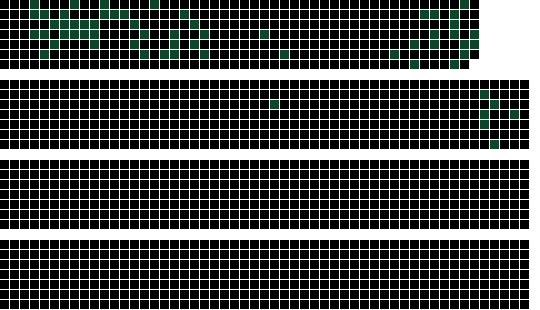

<h1>Bad-Apple-Contribution-Graph</h1>

 A Custom animation contribution graph playing Bad Apple on github Contribution Graph with 3289 frames.

 I do want to play or customize other videos. However, it takes a lot of time to edit all the files, so I'm looking forward for contributors to improve this project

  

### Contributing
Contributions, bug reports, and feature ideas are welcome!
1. Fork the repository.
2. Create a new branch
3. Create a pull request
By submitting a contribution to this repository, you agree that your contributions will be licensed under the same PolyForm Noncommercial License 1.0.0

### Third-Party Assets & Fan-Work Disclaimer
This project is an unofficial **Touhou Project** derivative work 
The PolyForm license above applies only to the original source code written by me (OxidaneCat). All rights to the underlying *Bad Apple!!* music, characters, and shadow-art animation belong to their respective creators:
* Original Composition and Touhou Project: ZUN (Touhou Gensokyo ~ Lotus Land Story)
* Music Arrangement and Vocals: Alstroemeria Records (Masayoshi Minoshima, Haruka, nomico)
* Shadow-Art Animation: Anira (あにら) & MMM (Storyboard)

[https://en.touhouwiki.net/wiki/Bad_Apple!!](https://en.touhouwiki.net/wiki/Bad_Apple!!)

